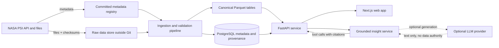
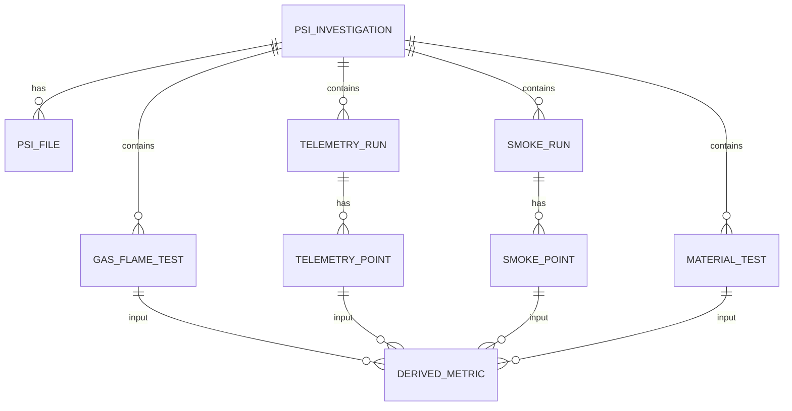
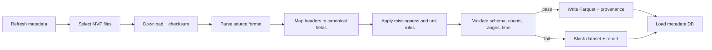
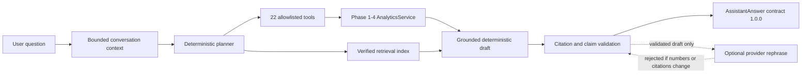

# Project Architecture

**Project:** Flame in Freefall
**Team:** AFAQ
**Challenge:** Flame in Freefall: SI-Powered Fire Safety Insights from Microgravity Combustion Data
**Status:** Architecture baseline after Phase 5. The repository contains verified metadata, a curated acquisition manifest, a checksum-verifying downloader, parsers, 13 canonical Parquet tables, validation and quality reports, comparability and serving registries, a bounded DuckDB query layer, a read-only FastAPI service with citations and scientific metadata contracts, a Next.js frontend that renders them, and a deterministic grounded assistant with verified retrieval, allowlisted tools, citation validation, and a golden evaluation. It does not yet contain a verified paired-comparison executor, a real-model evaluation, or a production data store.

This document describes the target system and the boundaries between what exists now and what must be built next. It is intentionally explicit about provenance, missingness, and scientific limits, because those are product requirements, not implementation details.

---

## 1. Goals and non-goals

### 1.1 Goals

1. Make verified NASA microgravity-combustion data explorable without distorting it.
2. Preserve the link between every displayed value and its source file, row, field, unit, and retrieval date.
3. Support comparison only where the underlying fields are semantically compatible.
4. Surface missing data, experimental-table-only records, and calibration limits instead of hiding them.
5. Provide a grounded insight layer that answers questions from computed data and cited documents, not from model memory.
6. Remain reproducible: a fresh checkout plus the documented commands must regenerate the metadata snapshot and validate it against the live NASA PSI API.
7. Keep the raw NASA archive out of Git. The repository stores metadata, checksums, small fixtures, and code.

### 1.2 Non-goals for the MVP

- Training a new scientific model or claiming predictive accuracy that has not been validated.
- Deriving flame-spread rates from BASS/BASS-II video. That requires a separate computer-vision program with its own validation.
- Treating FLEX-2, SAFFIRE-II, or ACME E-FIELD as raw measurement datasets. They expose zero `added` files; only their small public summary tables are usable, within the documented limits. FLEX (PSI-69) has a 274-row droplet summary and is supporting context, not a flame-spread dataset.
- Reproducing NASA's full telemetry processing chain. The MVP uses published summary tables and published telemetry exports.
- Producing a single "fire risk score" or ranking materials on an arbitrary index.
- Replacing NASA documentation with generated prose. The platform links to the source.

---

## 2. Design principles

| Principle | Consequence |
|---|---|
| **Provenance first** | Every observation carries `source_accession`, `source_file`, `source_sheet`, `source_row`, `source_sha256`, and `retrieved_at`. |
| **Raw is immutable** | Downloaded files are stored read-only outside Git. Parsers never modify raw bytes. |
| **Missingness is explicit** | Blank cells and sentinel tokens become typed quality flags. They are never coerced to zero. |
| **Units are part of the value** | A numeric value without a unit is incomplete. Unknown units are labeled `not stated`, not guessed. |
| **Computed is labeled** | `Tad`, `Zst`, derived rates, and aggregates are marked computed with a method version. |
| **Fail closed** | If a schema, checksum, or row-count gate fails, the dataset is marked blocked and is not served as valid. |
| **Comparability is curated** | Cross-dataset joins require an explicit mapping and a documented rationale. |
| **No hidden extrapolation** | The API never fills missing values or synthesizes rows. The insight layer never answers from memory when a tool result is required. |
| **Reproducible by default** | The metadata snapshot is regenerated by a standard-library script; data transformations are versioned and tested. |
| **Accessible and honest UI** | Charts label units, missingness, and source. No dual axes, no unlabeled smoothing, no decorative precision. |

---

## 3. Current state versus target state

### 3.1 Implemented in Phase 0 and Phase 1

- `scripts/fetch_psi_metadata.py`: standard-library PSI metadata collector with `--check`, `--details-dir`, and `--raw-dir`.
- `scripts/build_mvp_catalog.py`: reproducible MVP catalog generator with `--check`.
- `scripts/build_download_manifest.py`: builds or checks the curated 72-file acquisition selection.
- `scripts/download_psi_files.py`: thin wrapper around the acquisition CLI.
- `scripts/build_et_schemas.py`: builds or checks exact headers, row counts, encodings, and checksums for the 22 experimental tables.
- `scripts/build_fixtures.py`: builds or checks seven authentic NASA fixtures without rewriting the manifest in `--check` mode.
- `data/registry/psi_combustion_investigations.json`: 24 combustion investigations, generated from the PSI detail API.
- `data/registry/psi_file_inventory.csv`: 16,354 current `added` files.
- `data/registry/psi_experimental_tables.csv`: 22 public experimental summary tables.
- `data/registry/annotations.json`: curated roles, rationales, limitations, table statistics, and checksums.
- `data/registry/mvp_dataset_catalog.json`: machine-readable MVP catalog with roles and archive status.
- `data/registry/download_manifest.json`: curated 72-file acquisition selection with limits, URLs, and expected checksums.
- `data/registry/experimental_table_schemas.json`: exact header and row-count registry for all 22 experimental tables.
- `data/registry/canonical_schema.json`: implemented Arrow schema and primary keys for 13 canonical tables.
- `data/manifests/download_manifest.csv`: acquisition status, HTTP status, bytes, SHA-256, retrieval time, attempts, and errors.
- `data/reports/acquisition_report.json`, `validation_report.json`, `dataset_quality_report.json`, and `processing_report.json`.
- `src/data_pipeline/`: downloader, manifest, provenance, channels, parsers, Parquet schemas, parse orchestration, canonical builders, validation, quality, and CLI.
- `data/fixtures/`: seven exact excerpts from authenticated NASA sources with checksums and source-row provenance.
- `tests/`: 297 unit, contract, and integration tests covering parsers, schemas, downloader safety, CLI routing, validation failure paths, comparability, serving states, DuckDB queries, API contracts, Phase 4 metadata contracts, caching, rate limiting, and full-data counts.
- `src/analytics/`: comparability engine, serving engine, registry loaders, bounded DuckDB operations, API-ready service envelopes, typed errors, logging, citations, dataset metadata, publications, facets, paired-value eligibility, and measurement integrity.
- `data/metadata/comparability_registry.json`: 93 measurements and 60 pair-specific comparison rules.
- `data/metadata/serving_registry.json`: 9 curated dataset states and 93 measurement states across four uses.
- `data/metadata/paired_alignment_registry.json`: deliberately empty alignment registry; no verified paired-comparison method is committed.
- `backend/`: read-only FastAPI application with 35 paths, strict query validation, shared envelopes, request IDs, CORS, ETag caching, rate limiting, and OpenAPI.
- `frontend/`: Next.js 16 App Router application with 18 routes, including `/assistant`, a centralized typed API client, TanStack Query hooks, lazy-loaded Recharts time-series and paired-scatter panels, responsive navigation, scientific state components, citation drawer, file browser, field dictionary, limitations panel, publications pages, and dynamic facets.
- `frontend/tests/` and `frontend/e2e/`: 68 Vitest/React Testing Library tests, 27 real-backend Playwright flows, and 7 axe WCAG scans.
- `src/assistant/`: versioned answer contract, environment-driven configuration, deterministic planner, 22 allowlisted tools, verified retrieval index, grounded composer, citation and claim validators, optional provider boundary, orchestrator, bounded conversation state, and evaluation harness.
- `scripts/build_assistant_index.py` and `scripts/evaluate_assistant.py`: reproducible retrieval-index build/check and golden-set, retrieval, and provider-boundary evaluation.
- `docs/phase5-assistant-architecture.md`, `docs/assistant-answer-contract.md`, `docs/assistant-tools.md`, `docs/assistant-retrieval.md`, `docs/assistant-evaluation.md`, `docs/assistant-security.md`: assistant architecture, contract, tool catalog, retrieval design, evaluation, and threat model.
- `scripts/build_phase2_registries.py`: deterministic registry generator with `--check`.
- `docs/comparability.md`, `docs/serving-states.md`, `docs/query-contract.md`, `docs/api-implementation.md`, `docs/frontend-readiness.md`, `docs/phase4-contracts.md`, `docs/comparison-alignment.md`, `docs/known-limitations.md`: contracts, methodology, limitations, and frontend handoff.
- `DATA_SOURCES.md`: verified source inventory, per-record cards, comparability matrix, access limitations, verification log.
- `DATA_DICTIONARY.md`: exact source headers, units, missingness, the implemented canonical schema, and Phase 4 metadata contracts.
- Architecture, roadmap, API contract, contribution guide, and decision records.

### 3.2 Not implemented yet

- A real language-model evaluation. The optional provider boundary exists and is tested with deterministic stubs; no hosted model was called.
- A verified paired-comparison executor. The API exposes eligibility and withholds values.
- Authentication or user accounts. The public read-only MVP does not need them.
- CI/CD, deployment, observability, and production operations.
- A production data store and external cache. Caching and rate limiting are process-local.

The roadmap in `DEVELOPMENT_ROADMAP.md` defines the gates between these states.

---

## 4. System context



The LLM is optional. The platform must remain useful and truthful without it. When enabled, it receives tool results and citation identifiers, not unchecked authority over the data.

---

## 5. Logical architecture

### 5.1 Layers

| Layer | Responsibility | Technology |
|---|---|---|
| Source | NASA PSI API, file downloads, readmes, publications | HTTPS, JSON, CSV, XLSX, XLS, PDF, DOCX |
| Registry | Immutable metadata snapshot and curated annotations | JSON, CSV, Git |
| Ingestion | Download, checksum, parse, normalize, validate | Python 3.12, `httpx`, `polars`, `pyarrow`, `openpyxl`, `xlrd` |
| Storage | Raw object store, canonical Parquet, metadata database | S3-compatible storage or local filesystem; PostgreSQL; DuckDB for analytical reads |
| Serving | Read-only API with provenance and validation | FastAPI, Pydantic v2, SQLAlchemy 2, Alembic |
| Presentation | Catalog, explorers, comparisons, methods, assistant | Next.js, TypeScript, Tailwind CSS, TanStack Query, uPlot/Plotly |
| Insight | Retrieval, tool orchestration, citation enforcement, evals | Python, provider-agnostic LLM client, deterministic tools |
| Operations | CI/CD, logs, metrics, traces, backups, alerts | GitHub Actions, OpenTelemetry, container runtime |

### 5.2 Why this shape

- **Separation of raw and canonical data** prevents a parser bug from destroying the source and makes re-processing possible.
- **Parquet plus DuckDB** handles the modest MVP volume (thousands to tens of thousands of rows) without a heavyweight warehouse. PostgreSQL stores metadata, provenance, and user-facing catalog state.
- **A read-only API** keeps query logic server-side and prevents the browser from receiving arbitrary SQL or file paths.
- **A separate insight service** keeps LLM credentials and prompt logic out of the frontend and makes citation enforcement testable.
- **Static metadata in Git** makes the scientific inventory reviewable in pull requests, even when the raw files are not in the repository.

---

## 6. Data architecture

### 6.1 Storage zones

```text
data/
├── registry/           committed metadata, annotations, catalog, manifest, schema
├── manifests/          committed acquisition manifest with checksums and timestamps
├── reports/            committed acquisition, validation, quality, and processing reports
├── raw/                gitignored; exact NASA downloads, read-only
├── interim/            gitignored; parsed but not validated
├── processed/          gitignored; canonical Parquet, versioned
└── fixtures/           committed small samples for parser tests
```

Only `data/registry/`, `data/manifests/`, `data/reports/`, and `data/fixtures/` are committed. Raw, interim, and processed data are reproducible artifacts. A processed artifact is identified by a `dataset_version` derived from the source checksums and the pipeline/parser/schema versions.

### 6.2 Provenance envelope

Every canonical row carries:

| Field | Purpose |
|---|---|
| `source_accession` | PSI investigation. |
| `source_file` | Exact file name. |
| `source_sheet` | Workbook sheet, when applicable. |
| `source_row` | 1-based data row after the header. |
| `source_sha256` | Checksum of the source file. |
| `retrieved_at` | Retrieval timestamp. |
| `parser_version` | Version of the parser that produced the row. |
| `quality_flags` | Missingness, sentinel, constant-channel, or calibration flags. |

Derived metrics add `input_observation_ids`, `method`, `method_version`, `uncertainty`, and `limitations`. A derived metric without those fields is invalid.

### 6.3 Canonical tables

The full column definitions are in `DATA_DICTIONARY.md`. The relationships are:



Key design choices:

- **Gas-flame summary tables are wide canonical rows.** They are small, test-oriented, and naturally comparable after field mapping.
- **Telemetry and smoke data are tidy long tables.** A channel-level row makes units, missingness, and provenance explicit and avoids a 98-column sparse table in the serving layer.
- **Material test matrices are wide canonical rows.** They are test logs, not time series.
- **Derived metrics are separate.** A mean, rate, or comparison never overwrites a source value.

### 6.4 Dataset versions

A canonical dataset version is:

```text
sha256(
  sorted(source_file_id + source_sha256 list)
  + parser_version
  + pipeline_version
  + canonical_schema_version
)
```

The current Phase 1 dataset version is:

```text
2a19f9f2e7dda7bb41d6d83c3c1a4b3b616c1d91849f7edb2e749f89708934cb
```

The version is stored in `data/processed/dataset_manifest.json` and `data/reports/processing_report.json`. A change in any input or transformation produces a new version. The UI can show "data version" and "retrieved at" without exposing a Git commit as a proxy for data freshness.

### 6.5 Raw data handling

- Downloads are streamed to `data/raw/<accession>/<file_name>` with a temporary file and atomic rename.
- The downloader verifies the HTTP status, content length when available, and SHA-256.
- A file listed in the PSI inventory that returns 404 is recorded as `listed_404`, not silently skipped.
- Large files are never committed. The repository stores file names, sizes, checksums, and access status.
- The downloader is resumable and rate-limited. It does not bypass authentication or access controls.

---

## 7. Ingestion and validation pipeline

### 7.1 Stages



### 7.2 Stage contracts

| Stage | Input | Output | Gate |
|---|---|---|---|
| Refresh metadata | PSI search/detail API | Registry snapshot | 24 combustion records; counts and sizes match or drift is reported |
| Select MVP files | Registry + annotations | Download manifest | Only files with a documented role; `experimental_table_only` records contribute their verified summary table, not a fabricated archive |
| Download | Manifest | Raw files + checksums | HTTP 200, size match, SHA-256 recorded |
| Parse | Raw file | Interim table | Exact header match; sheet existence; no silent type coercion |
| Map | Interim table | Canonical fields | Every canonical field has a source field or a documented derivation |
| Missingness | Canonical fields | Quality flags | Every blank/sentinel token is classified |
| Validate | Canonical table | Pass/fail report | Row counts, time monotonicity, range checks, unit checks, cross-field checks |
| Publish | Validated table | Parquet + metadata | Versioned, checksummed, queryable |

### 7.3 Validation rules (initial set)

**PSI-10 / PSI-159**

- Row counts match the committed table statistics.
- `XO2` values are in `[0, 1]` when numeric.
- Pressures are positive when numeric.
- `Tad (K)` is positive when numeric.
- `RAMP`, `RAMPED`, `LOW O2`, `#DIV/0!`, `#VALUE!`, and `-` are flagged, not coerced.
- PSI-159 inverse has 861 all-blank trailing rows; the valid row count is 154.
- `TFP` is treated as a categorical flag, never as a temperature.

**PSI-100**

- `RelativeSeconds` is treated as milliseconds.
- Negative/sentinel time rows are flagged and excluded from time-series joins.
- The raw CSV, cleaned CSV, and XLSX are separate exports; no concatenation.
- Constant channels are flagged. A constant channel is not evidence of a physical constant.
- Channels with `not stated` units are not plotted on a physical axis without a calibration note.

**PSI-101**

- `Time` is Unix seconds; `TimeString` is year/day-of-year/time.
- `PTrakMeasurement(PtPerCC)` `-999` is flagged as a sentinel.
- `DustTrakA` all-zero is flagged as possibly inactive.
- Device state columns are not treated as physical measurements.
- Run metadata is joined from the test logs, not inferred from the CSV row.

**PSI-25 / PSI-26**

- `none`, `n/a`, `OR`, `-1`, and free text are preserved.
- No spread rate is computed or displayed.
- `Air display` and `Fan display` remain source text unless a documented unit mapping is applied.
- BASS/BASS-II test matrices are labeled as test logs, not measurement tables.

### 7.4 Fail-closed behavior

If a gate fails:

1. The dataset version is marked `blocked`.
2. The API continues to serve the last known good version, with a stale/blocked badge, or returns `409` for the blocked version.
3. The failure is logged with the source file, row, field, and expected/actual values.
4. The UI does not show the blocked table as valid.
5. A human review is required to accept a schema change or a new interpretation.

---

## 8. API architecture

The full contract is in `API_DOCUMENTATION.md`; the implemented surface is in `docs/api-implementation.md`. The architecture is:

```text
Client
  -> FastAPI router (strict query allowlist, request ID, CORS)
  -> service layer (registries, serving, comparability, envelopes)
  -> DuckDB repository (read-only views over canonical Parquet)
  -> response serializer (provenance, units, quality flags, warnings)
```

The implemented service uses:

- `backend/app.py`: app factory, routes, strict query route, error handlers, CORS, request IDs, ETag middleware, rate-limit middleware, structured request logging.
- `backend/models.py`: Pydantic success and error envelopes.
- `backend/operations.py`: cache settings, ETag generation, conditional-request matching, and the process-local fixed-window rate limiter.
- `src/analytics/service.py`: API-ready shaping over registries, quality, queries, and Phase 4 contracts.
- `src/analytics/db.py`: named, bounded DuckDB operations.
- `src/analytics/comparability.py` and `src/analytics/serving.py`: scientific decisions.
- `src/analytics/citations.py`: stable file and row citation IDs, checksum and retrieval evidence, row verification.
- `src/analytics/dataset_metadata.py`: curated file manifests, field dictionaries, source-column mappings, and scoped limitations.
- `src/analytics/publications.py`: publication deduplication, conflict preservation, and verification status.
- `src/analytics/facets.py`: facet counts and per-accession distributions from canonical gas-flame rows.
- `src/analytics/paired.py`: paired-value eligibility, conditions, alignment requirements, and withholding reasons.
- `src/analytics/integrity.py`: canonical-data presence checks for registry measurements.
- `data/metadata/*.json`: committed comparability, serving, and paired-alignment registries.

### 8.1 Design rules

- **Read-only by default.** The public API exposes no write endpoints.
- **Allowlisted datasets and fields.** No arbitrary file paths, table names, or SQL.
- **Parameterized queries only.** The client cannot generate SQL.
- **Pagination and limits.** Pages are capped at 200 rows; series at 20,000 points and 8 channels; oversized ranges return `413 range_too_large`.
- **Strict query parameters.** Unknown or repeated parameters are rejected with `400 invalid_query`.
- **Units in every response.** A numeric value includes `unit` or `not stated`.
- **Quality flags in every response.** Missingness, sentinels, calibration limits, and serving restrictions travel with the payload.
- **Provenance in every data response.** Dataset version, source file, row or row range, checksum, and retrieval time.
- **Stable error codes.** `invalid_query`, `not_found`, `unknown_measurement`, `range_too_large`, `validation_error`, `rate_limited`, `service_unavailable`, `query_timeout`, `query_error`, `internal_error`.
- **Scientific decisions are payloads.** `GET /compare` returns `200` with the comparability state, including `blocked` and `not_comparable`.
- **No hidden aggregation.** The API returns bounded rows and series; it does not compute new scientific aggregates.
- **No fabricated citations or publications.** Missing metadata is `null` with an explicit status, never inferred.

### 8.2 Caching and operations

- CORS origins come from `FLAME_CORS_ORIGINS`.
- `X-Request-ID` is echoed or generated and appears in the envelope.
- Query timeout comes from `FLAME_QUERY_TIMEOUT_SECONDS` (default 10 s).
- Successful `GET` JSON responses except `/health` receive a strong `ETag` over a stable body representation that excludes `meta.request_id` and `meta.generated_at`.
- `Cache-Control` defaults to `public, max-age=60, must-revalidate`; `FLAME_CACHE_ENABLED`, `FLAME_CACHE_MAX_AGE`, and `FLAME_CACHE_CONTROL` configure it.
- `If-None-Match` returns `304` with the same validator. Errors and health responses use `no-store`.
- Rate limiting is a process-local fixed window keyed by client IP: 600 requests per 60 seconds by default. `FLAME_RATE_LIMIT_ENABLED`, `FLAME_RATE_LIMIT_REQUESTS`, `FLAME_RATE_LIMIT_WINDOW_SECONDS`, and `FLAME_TRUST_PROXY` configure it.
- Every request emits one JSON log line with `request_id`, `method`, `path`, `status`, and `duration_ms`.
- Authentication is intentionally absent for the public read-only MVP. Rate limiting is not authentication; adding private data or write operations requires an authentication layer.

---

## 9. Frontend architecture

### 9.1 Stack

Implemented in `frontend/`:

- Next.js 16.4.5 with the App Router and TypeScript 5.9.3.
- React 19.3.1 and Tailwind CSS 4.3.5 for layout and design tokens.
- TanStack Query 5.107.1 for server state.
- Recharts 3.10.1 for bounded time-series panels. It is the single charting library; the app does not add a second renderer.
- Lucide React for icons and a small accessible component library. No decorative chartjunk.
- Vitest, React Testing Library, Playwright, and axe-core for tests.

The `dev` and `build` scripts use the webpack builder explicitly.

### 9.2 Pages

| Page | Purpose |
|---|---|
| `/` | Overview: live registry counts, serving-state distribution, quality summary, limitations, quick links. |
| `/investigations` | Searchable, filterable, paginated investigation catalog. |
| `/investigations/[accession]` | Investigation detail with curated datasets, measurements, warnings, and source references. |
| `/datasets` | Curated dataset catalog with role, access, serving state, and quality. |
| `/datasets/[datasetId]` | Dataset detail: measurements, field dictionary, curated files, limitations, publications, units, calibration, serving decisions, provenance. |
| `/experiments/gas-flame` | Gas-flame test explorer for PSI-10 and PSI-159 with accession-bound filters and backend facets. |
| `/experiments/materials` | PSI-25 and PSI-26 material matrices with oxygen-ambiguity warnings. |
| `/experiments/droplets` | PSI-69 droplet summary with the source-labeled burning-rate unit. |
| `/telemetry` | SAFFIRE-III run and bounded time-series explorer. |
| `/smoke` | SAME-R run and bounded time-series explorer. |
| `/compare` | Backend-authoritative measurement comparison studio with integrity and paired-value eligibility panels. |
| `/quality` | Registry-wide and per-dataset quality, serving, and limitation center. |
| `/provenance` | Exact source-file and row resolution with file and row citation drawers. |
| `/publications` | Deduplicated publication list with verification and missing-field status. |
| `/publications/[publicationId]` | Publication detail with related investigations, DOI, and provenance. |
| `/about` | Data sources, processing, comparability, quality, limitations, and citation policy. |
| `/assistant` | Grounded research assistant with conversation, suggested questions, evidence panel, citation drawer, validation status, and provider/fallback state. |

### 9.3 UI rules

1. Every chart has a title, x-axis unit, y-axis unit, source accession, and a provenance or source link.
2. Missingness is visible. Do not interpolate across gaps without a labeled method.
3. No dual y-axes. If two units must be compared, use two stacked panels or a normalized view with an explicit explanation.
4. No smoothing, binning, or aggregation without a visible method note.
5. No color-only encoding. Use labels and patterns where possible.
6. No "risk score" badge unless a documented, validated metric exists.
7. Records with no `added` archive but a public experimental table show the verified table and an `experimental_table_only` badge; records with no public artifact show "No public files". Neither shows an empty chart that looks like zero data.
8. The assistant shows `measured`, `computed`, `derived`, `raw`, or `not available` for each supporting value, displays exact serialized numbers without frontend rounding, and marks documentary evidence as context rather than a numerical source.
9. The citation drawer lists the accession, file, field, row/range, checksum, retrieval date, and verification status. It never shows a download link for an unavailable file.
10. The interface is keyboard accessible and meets WCAG 2.1 AA contrast and focus requirements. Seven axe scans currently report no serious or critical violations.
11. The comparison studio renders a paired chart only when the backend returns `paired_values.available=true`, `alignment.verified=true`, and numeric points. Otherwise it explains the withholding reason.
12. Dynamic facet counts come from the backend and preserve accession-specific units; the UI never merges PSI-10 atm with PSI-159 bar.

### 9.4 State boundaries

- The frontend never computes scientific aggregates that the API does not expose, except trivial display formatting.
- The frontend never fills missing values.
- The frontend never labels a value with a unit that the API does not provide.
- The frontend never converts units, concatenates runs, downsamples series, or retries a `413` silently.
- The frontend never caches an assistant answer without its citations and dataset version.

### 9.5 API client boundary

`frontend/src/lib/api/client.ts` owns the base URL, timeout, cancellation, query serialization, error normalization, and envelope handling. `endpoints.ts` defines typed endpoint functions; `hooks.ts` wraps them in TanStack Query. Components never call `fetch` directly. The OpenAPI schema is generic (`data: Any`), so domain types in `types.ts` are maintained against observed responses and contract tests rather than generated.

### 9.6 Known frontend limits

- The assistant UI renders validated backend answers only. It does not call a model directly, generate citations, or compute numbers. A real-model evaluation has not been run.
- Assistant values are displayed with the backend's exact serialization; the UI does not round scientific numbers.
- Paired comparison values are not produced from current canonical data; the chart remains conditional and is tested with isolated fixtures. The backend returns `paired_values.available=false`.
- ETag/304 is handled by the browser cache; the frontend does not implement custom revalidation logic.
- Visual regression tests remain open. Automated responsive-viewport coverage exists for the dataset metadata page and the main routes.
- Turbopack is not used in the checked-in scripts; webpack is the supported build path for the current dependency layout.

---

## 10. Grounded insight layer

### 10.1 Purpose

The challenge calls for SI-powered fire-safety insights. The insight layer helps users find, compare, and explain verified observations. It does not invent measurements, competition facts, or NASA conclusions. It is deterministic by default and works with no language model configured.

Phase 5 implements this layer. The normative documents are `docs/phase5-assistant-architecture.md`, `docs/assistant-answer-contract.md`, `docs/assistant-tools.md`, `docs/assistant-retrieval.md`, `docs/assistant-evaluation.md`, and `docs/assistant-security.md`.

### 10.2 Architecture



The optional provider is a rephrase boundary, not a reasoning layer. It receives the user question and the validated deterministic draft. It never selects tools, sees retrieved source text as instructions, or creates numbers, citations, accessions, dataset IDs, or URLs.

### 10.3 Components

| Component | File | Responsibility |
|---|---|---|
| Contract | `src/assistant/contract.py` | Versioned answer, claim, citation, evidence, and status models |
| Configuration | `src/assistant/config.py` | Environment validation, secret-free status, safe deterministic fallback |
| Planner | `src/assistant/planner.py` | Closed topic selection and fixed tool sequences |
| Tools | `src/assistant/tools.py` | 22 typed, allowlisted wrappers over existing service methods |
| Retrieval | `src/assistant/retrieval.py` | Verified-document index, BM25 + hashed TF-IDF, source manifest |
| Composer | `src/assistant/composer.py` | Grounded templates, supporting data, and claims |
| Citation validation | `src/assistant/citation_validation.py` | Independent Phase 4 citation resolution and scope checks |
| Claim validation | `src/assistant/claim_validation.py` | Number, unit, value-kind, scope, and forbidden-claim checks |
| Providers | `src/assistant/providers.py` | Deterministic default and optional rephrase provider |
| Orchestrator | `src/assistant/orchestrator.py` | End-to-end pipeline, fallback, and status |
| Conversation | `src/assistant/conversation.py` | Bounded, non-authoritative follow-up state |
| Evaluation | `src/assistant/evaluation.py` | Golden, retrieval, provider-boundary, and latency metrics |

### 10.4 Tools

The assistant has exactly 22 tools, grouped as catalog, metadata, provenance, publications, gas-flame rows and statistics, material and droplet rows, telemetry and smoke series, comparison eligibility, and verified retrieval. The full argument schemas are served by `GET /api/v1/assistant/tools` and documented in `docs/assistant-tools.md`.

There is no SQL, filesystem, URL-fetch, shell, or code-execution tool. A tool result carries units, value kind, scope, citation IDs, and a bounded summary. The composer copies values from the result; it does not recompute them from prose.

### 10.5 Answer contract

Every answer returns contract version `1.0.0` inside the shared API envelope:

```json
{
  "contract_version": "1.0.0",
  "answer": "Grounded prose.",
  "answer_type": "numerical",
  "evidence_status": "fully_supported",
  "citations": [
    {"citation_id": "cit_f_...", "citation_type": "file", "accession": "PSI-159", "file_name": "...", "resolved": true}
  ],
  "claims": [
    {"claim_id": "clm_1", "claim_type": "numerical", "text": "...", "value": 333, "unit": "values", "value_kind": "derived", "citation_ids": ["cit_f_..."], "tool_call_id": "tc_1", "supported": true}
  ],
  "supporting_data": [],
  "limitations": [],
  "tools_used": [],
  "validation": {"passed": true, "citation_validation_passed": true, "claim_validation_passed": true, "checks": [], "errors": [], "warnings": []}
}
```

`evidence_status` is one of `fully_supported`, `partially_supported`, `insufficient_evidence`, `unavailable_data`, or `conflicting_evidence`. `answer_type` is one of `factual`, `numerical`, `exploratory`, `comparison`, `methodology`, or `clarification_required`. Missing values are reported as missing, never as zero. Documentary retrieval is labeled as context and is not a numerical source.

### 10.6 Guardrails

1. **No tool, no number.** A numeric claim must link to a current tool call; the validator withholds the draft otherwise.
2. **No memory of NASA data.** The model may know general combustion science, but it cannot attribute a number to NASA data without a tool result.
3. **No unsupported causation.** Correlation is not presented as causation.
4. **No risk scores or material rankings.** The assistant cannot rank materials or tests on an invented index.
5. **No false archive claims.** `experimental_table_only` and `no_public_files` datasets are described with their verified limits.
6. **No unit guessing.** Ambiguous units are labeled as ambiguous; no conversion is performed without an approved rule.
7. **No prompt injection from data.** Retrieved text and free-text fields are evidence, never instructions. The provider never receives them as instructions.
8. **No hidden context.** Tool calls, citations, supporting data, and validation results are exposed.
9. **No answer without relevant limitations.** Dataset limitations are included when they affect the answer.
10. **No silent fallback.** A failing provider falls back to the validated deterministic draft and the status reports the fallback reason.
11. **No fabricated citations.** Every citation resolves through the Phase 4 citation service before the answer is returned.
12. **No paired values without a verified alignment.** The registry is empty, so the assistant states the withholding reason and computes no paired statistic.

### 10.7 Evaluation

The committed deterministic run reports:

| Metric | Result |
|---|---:|
| Golden questions | 36 / 36 |
| Citation references valid | 117 / 117 |
| Supported claims | 59 / 59 |
| Numerical exact match | 30 / 30 |
| Unit consistency | 30 / 30 |
| Tool-selection accuracy | 35 / 35 |
| Correct refusals | 12 / 12 |
| Retrieval precision@5 | 0.602381 |
| Retrieval recall@5 | 1.0 |
| Retrieval MRR | 0.761905 |

The harness reports separate metrics rather than one aggregate score. Failing-provider and deterministic mock-provider checks are software boundary checks, not a real-model evaluation. The golden set is version `1.0.1` and is bound to the canonical dataset version. A release is blocked if citation validity, numerical/unit consistency, tool selection, refusal behavior, or the golden set fails.

---

## 11. Security and privacy

### 11.1 Secrets

- No credentials in Git.
- `.env` is ignored; `.env.example` contains placeholders only.
- LLM and database credentials are injected at runtime.
- CI uses short-lived tokens or repository secrets; logs redact secrets.

### 11.2 API

- CORS allowlist per environment.
- Rate limiting per IP and per API key (if keys are added).
- Request size limits and time-range limits.
- Pydantic validation for every parameter.
- Allowlisted dataset IDs, field names, and channel names.
- Parameterized queries only; no string interpolation into SQL.
- Read-only database role for the public API.
- No directory traversal in file or provenance endpoints.

### 11.3 Data and content

- NASA data are public, but the platform must not imply NASA endorsement.
- No personal data is collected in the MVP. If analytics are added, they must be documented and minimized.
- Free-text comments from NASA files are untrusted input. Escape them in the UI and delimit them in LLM prompts.
- The assistant must not execute code or fetch arbitrary URLs from user input.

### 11.4 Supply chain

- Lockfiles committed for application dependencies.
- Dependency and container scanning in CI.
- SBOM generated for release images.
- No unpinned `latest` images in production.

---

## 12. Observability

### 12.1 Logs

Structured JSON logs with:

- `request_id`
- `route`
- `dataset_version`
- `accession`
- `status_code`
- `latency_ms`
- `error_code`
- `tool_name` for assistant requests

Logs never include secrets or full raw rows.

### 12.2 Metrics

- API request rate, latency, error rate.
- Cache hit rate.
- Dataset freshness (`registry_snapshot_age_days`).
- Ingestion success/failure count.
- Checksum mismatch count.
- Blocked dataset count.
- Assistant citation coverage and refusal rate.
- LLM provider error rate and latency.

### 12.3 Alerts

- PSI metadata drift detected by `--check`.
- A previously available file returns 404.
- A parser schema check fails.
- A dataset is blocked.
- API error rate or latency exceeds the agreed threshold.
- Assistant citation coverage drops below 100% for numeric claims.

### 12.4 Data quality dashboard

A read-only internal page shows, per dataset:

- source checksum and retrieval date;
- row counts and valid row counts;
- missingness by field;
- sentinel counts;
- constant channels;
- unit status (`stated`, `not stated`, `derived`);
- validation gate status.

---

## 13. Deployment

### 13.1 Environments

| Environment | Purpose | Data |
|---|---|---|
| Local | Development and tests | Registry + small fixtures; raw data optional |
| Staging | Integration and demo rehearsal | Full MVP processed data; synthetic user traffic only |
| Production | Public demo | Full MVP processed data; read-only API |

### 13.2 Local composition

```text
docker compose up
  api        FastAPI + Uvicorn
  web        Next.js
  postgres   metadata and provenance
  minio      optional S3-compatible object store for raw/processed data
```

DuckDB can read Parquet directly for local development, so MinIO is optional. PostgreSQL is required for metadata and provenance in staging/production.

### 13.3 Production topology

- Container images for `api`, `web`, and `insight`.
- Managed PostgreSQL with backups and point-in-time recovery.
- Object storage for raw and processed data, with lifecycle policies.
- CDN for the web app and static assets.
- Read replicas or a read-only role for analytical queries if needed.
- A scheduled metadata refresh job and a separate ingestion job.
- No raw data in the web container.

### 13.4 CI/CD

**CI**

1. Lint and format.
2. Type check.
3. Unit tests.
4. Parser fixture tests.
5. Data validation tests.
6. API contract tests.
7. Frontend build and accessibility checks.
8. Assistant golden-set evaluation.
9. Secret scan and dependency scan.

**CD**

1. Build and sign images.
2. Deploy to staging.
3. Run smoke tests and data-quality checks.
4. Promote to production with a manual approval.
5. Record the deployed image digest and dataset version.
6. Roll back on failed health or data-quality checks.

### 13.5 Backup and recovery

- PostgreSQL: daily backups, point-in-time recovery, restore drill.
- Object storage: versioning and lifecycle policy.
- Registry: Git history plus the generated snapshot.
- Processed data: regenerable from raw + pipeline version; checksums recorded.
- Recovery time and recovery point objectives are set with the deployment owner, not invented here.

---

## 14. Testing strategy

| Test layer | What it proves | Examples |
|---|---|---|
| Unit | Pure functions and parsers | Header mapping, sentinel classification, unit conversion |
| Fixture | Real file shapes | A 5-row CSV fixture with exact headers; an XLSX sheet fixture |
| Data quality | Source integrity | Row counts, checksums, time monotonicity, range checks |
| Contract | API shape | OpenAPI schema, error codes, pagination, citations |
| Integration | API + database + Parquet | Filter a test, fetch a telemetry range, resolve provenance |
| End-to-end | User flows | Catalog → dataset → chart → citation drawer |
| Accessibility | WCAG 2.1 AA | Keyboard navigation, contrast, screen-reader labels |
| Performance | Bounded response | Time-range limits, pagination, cache behavior |
| Security | Abuse resistance | Input validation, rate limits, path traversal, prompt injection |
| Assistant eval | Grounding | Golden questions, citation coverage, refusal behavior |

### 14.1 Test data policy

- Commit small fixtures with real headers and a few rows, not full NASA files.
- Fixtures must include the sentinel tokens they test.
- Do not commit raw telemetry or video.
- A fixture's checksum is recorded in the test, not in the production registry.

### 14.2 Definition of done for a parser

A parser is done when:

1. It reads the exact source header and fails on an unexpected header.
2. It classifies every observed missing/sentinel token.
3. It preserves raw values and units.
4. It has fixture tests for normal, missing, sentinel, and malformed rows.
5. It emits provenance for every row.
6. It passes the data-quality gates.
7. Its limitations are documented in `DATA_DICTIONARY.md`.

---

## 15. Failure modes and mitigations

| Failure | Impact | Mitigation |
|---|---|---|
| PSI API unavailable | Cannot refresh metadata | Serve committed registry with a stale badge; retry with backoff; never invent records |
| PSI file 404 | Missing measurement | Mark `listed_404`; show access limitation; do not substitute another file |
| Schema drift | Wrong column mapping | Fail closed; block dataset version; require review |
| Timestamp mismatch | Wrong time-series join | Keep exports separate; reconcile explicitly; never concatenate |
| Unit ambiguity | Wrong physical interpretation | Label `not stated`; hide physical-axis plotting until resolved |
| Missing values | False zeros | Quality flags; no coercion; missingness visible in UI |
| Large file | Slow download or memory | Stream, range requests, chunked parsing; keep raw out of Git |
| LLM hallucination | Unsupported claim | Tool-only numeric answers; citation validator; golden eval |
| Prompt injection in comments | Tool misuse | Delimit data; no instruction following from data; tool allowlist |
| Dataset blocked | Missing feature | Serve last known good version with badge, or explicit error |
| Secret leak | Security incident | `.env` ignored; secret scan; rotate credentials; no secrets in logs |

---

## 16. Architecture decisions and open questions

### 16.1 Decisions

- **ADR 0001:** MVP dataset selection. See `docs/decisions/0001-mvp-dataset-selection.md`.
- **ADR 0002:** Phase 1 pipeline contracts, sentinel policy, and canonical Parquet outputs. See `docs/decisions/0002-phase-1-pipeline-contracts.md`.
- **ADR 0003:** Phase 2 comparability registry, serving states, bounded DuckDB layer, and read-only API. See `docs/decisions/0003-phase-2-comparability-serving-and-api.md`.
- **Phase 4 metadata contracts:** citations are file-level by default and row-level on demand; dataset files are the curated manifest plus documented known-unavailable files; fields derive from the comparability registry and verified source columns; publications are deduplicated by DOI or normalized title with conflicts preserved; facets come from canonical rows; paired values are withheld without a verified alignment method. See `docs/phase4-contracts.md` and `docs/comparison-alignment.md`.
- **Metadata in Git, raw data outside Git.** This keeps the repository reviewable and avoids committing terabytes.
- **Summary tables first.** PSI-10 and PSI-159 are the initial gas-flame foundation; PSI-100 and PSI-101 are the initial telemetry/smoke foundation.
- **No BASS spread-rate derivation in the MVP.** The test matrices do not contain a processed spread rate, and video computer vision is a separate program.
- **No arbitrary risk score.** The platform presents measured and computed values, not an invented index.

### 16.2 Open decisions

1. **Charting library:** Recharts was selected for the frontend. A future high-density time-series view may add a second renderer only with an explicit accessibility and performance review.
2. **Analytical store:** DuckDB over Parquet for the MVP; PostgreSQL for metadata. Decided for Phase 2: DuckDB read-only views with bounded named queries. Revisit if concurrent analytical load grows.
3. **LLM provider:** provider-agnostic interface; no provider is required for the core product.
4. **Authentication:** not needed for the public MVP; revisit if saved views or private annotations are added.
5. **Processed data hosting:** local filesystem for development; object storage for staging/production.
6. **License:** not selected. Do not add a license file without a team decision.

---

## 17. Current milestone acceptance

Phase 1 is complete when:

1. The curated manifest selects only documented files and never the full archive.
2. Every selected file is present, size-checked, SHA-256 verified, and has a retrieval timestamp, or is explicitly documented as `listed_404`.
3. Parsers fail on unexpected headers and preserve every missing/sentinel token.
4. Interim and canonical Parquet tables reproduce the committed row counts.
5. Canonical rows carry accession, file, sheet, row, source URL, SHA-256, retrieval time, parser version, units, quality flags, and transformation history.
6. Acquisition and canonical validation pass with zero failures.
7. Unit and integration tests pass.
8. No raw NASA data, credentials, or `.env` file is committed.
9. The Phase 1 commit is pushed to `origin/main` and the remote SHA is verified.

Verified Phase 1 result:

- 72 selected files, 56,238,344 expected bytes; 70 downloaded, 2 already present, 0 failed.
- 72 / 72 checksums verified; 2 documented 404s re-verified.
- 79 parsed sources, 57 interim outputs.
- 13 canonical tables, 8,058,206 rows, 82,953,195 bytes.
- Acquisition validation pass; canonical validation pass (13 checks, 0 failed).
- Quality report pass with 6 issues: 0 errors, 5 warnings, 1 informational note.
- 150 tests pass: 136 unit, 14 integration.

Phase 2 is complete when:

1. A committed comparability registry covers every curated measurement and every approved comparison pair.
2. An unregistered pair defaults to `not_comparable`.
3. A committed serving registry evaluates every dataset and measurement for exploration, quantitative comparison, time series, and provenance.
4. DuckDB queries are named, read-only, parameterized, and bounded.
5. Oversized pages and series return an explicit error, never a silent downsample.
6. The read-only API exposes the catalog, datasets, quality, measurements, observation tables, telemetry, smoke, comparability, comparisons, and provenance.
7. Every response carries dataset version, provenance, quality state, and warnings.
8. Unknown or repeated query parameters are rejected.
9. Blocked comparisons return a scientific decision, not a transport failure.
10. Unit, API contract, and real-data integration tests pass.

Verified Phase 2 result:

- 93 measurements and 60 comparison rules.
- 9 dataset states and 93 measurement states across four uses.
- 13 read-only DuckDB views, 23 API paths, one success envelope, one error envelope.
- 270 tests pass: 239 unit, 31 integration.
- No canonical value, unit, or quality flag changed.

Phase 3 is complete when:

1. Every implemented API capability has a typed frontend contract and a TanStack Query hook.
2. The frontend renders backend serving, comparability, quality, calibration, and provenance decisions without recomputing them.
3. Missing values, raw/uncalibrated channels, and blocked comparisons have explicit UI states.
4. Series caps and `413` responses are surfaced, never hidden by silent downsampling.
5. Navigation, keyboard access, focus handling, and mobile layout work across all routes.
6. Unit/component tests, real-backend Playwright flows, and axe scans pass.
7. The production build succeeds.
8. The Phase 3 commit is pushed and the remote SHA is verified.

Verified Phase 3 result:

- 16 routes, 14 at the Phase 3 commit; 41 unit/component tests and 17 Playwright tests at delivery.
- Centralized typed API client with envelope handling and normalized errors.
- Lazy-loaded Recharts panels, scientific state badges, provenance blocks, and responsive navigation.
- Production build passes; four axe scans report no serious or critical violations.

Phase 4 is complete when:

1. Citations, dataset files, fields, limitations, publications, and gas-flame facets are implemented as read-only contracts.
2. Citations use stable IDs and verified checksums; unavailable files are never downloadable.
3. Field metadata uses canonical names, verified source columns, units, value kinds, calibration, missingness, and comparability restrictions without invented descriptions.
4. Limitations have stable IDs, scope, severity, affected operations, evidence, and resolution status.
5. Publications are deduplicated, conflicts are preserved, and missing year/venue are returned as unavailable.
6. Facets come from canonical rows, report exclusions, and preserve accession-specific units.
7. `/compare` exposes integrity checks and withholds paired values unless a verified alignment method exists.
8. ETag/`304`, `Cache-Control`, rate limiting, request IDs, and structured logs work and are configurable.
9. The frontend renders all new contracts with loading, empty, error, blocked, and unavailable states.
10. Backend, frontend, Playwright, axe, and build checks pass.

Verified Phase 4 result:

- 31 API paths and 297 backend tests.
- 54 frontend unit/component tests, 24 Playwright tests, 6 axe scans.
- 299 deduplicated publications, 235 with DOI, 64 without; year and venue unavailable.
- 74 file-level citations plus on-demand row citations; PSI-98's two known 404 files remain unavailable.
- Facet counts: PSI-10 327 total / 256 included / 71 excluded; PSI-159 333 / 333 / 0.
- Paired values withheld with `no_verified_alignment` or `conditions_not_verified`.

Phase 5 is complete when:

1. A versioned answer contract defines evidence status, answer type, claims, citations, supporting data, limitations, and validation.
2. Every tool is typed, allowlisted, bounded, and wraps an existing Phase 1–4 capability; no SQL, path, URL, or code execution is exposed.
3. Retrieval uses only verified committed artifacts, with source hashes, a manifest, metadata filtering, hybrid ranking, deduplication, and provenance.
4. Every citation resolves through the Phase 4 citation service, and every numeric claim links to a current tool call.
5. Refusal behavior is correct for missing values, unit ambiguity, unavailable files, and unverified comparisons.
6. The deterministic path works with no LLM; an optional provider may only rephrase a validated draft and fails closed.
7. Prompt injection and adversarial questions do not change tools, citations, secrets, or file access.
8. The `/assistant` route renders conversation, evidence, citations, suggested questions, and scientific transparency.
9. The golden set, retrieval set, provider-boundary checks, backend tests, frontend tests, Playwright, axe, and production build pass.
10. Documentation and the generated evaluation report match the implemented behavior.

Verified Phase 5 result:

- 35 API paths and 483 backend tests.
- 22 allowlisted deterministic tools and 1,391 verified retrieval chunks.
- 36 / 36 golden questions; 117 / 117 citations valid; 59 / 59 claims supported; 30 / 30 numerical and unit checks; 12 / 12 correct refusals.
- 68 frontend unit/component tests, 27 Playwright tests, 7 axe scans, and a passing production build with `/assistant`.
- No real language model was evaluated; the provider boundary is exercised with deterministic stubs.
- Paired values remain unavailable because the alignment registry is empty.
- PSI-159 `pressure_initial_atm` and PSI-10 `pressure_approx_bar` remain empty and are never treated as zero.
- The two PSI-98 telemetry/sensor workbooks remain unavailable (HTTP 404).

Remaining product work is a verified paired-comparison executor, a real-model evaluation when credentials exist, deployment operations, and the Phase 6 hardening work.
